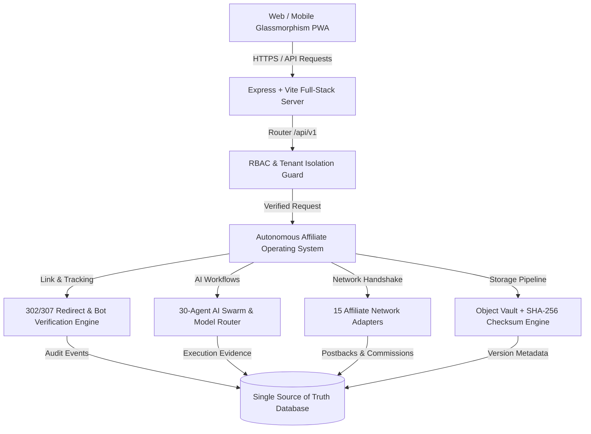

# SUPER AFFILIATE MANAGER AI — SYSTEM ARCHITECTURE

## 1. High-Level Architecture Diagram (Mermaid)



## 2. Universal Tracking Pipeline

```
Visitor Click
  └──> /api/v1/track/:slug
        ├──> Bot & Fraud Check (User-Agent & IP Hash)
        ├──> Link Active & Destination Validation
        ├──> Click Event Persistence (Gate 7)
        ├──> Financial Aggregation Update
        ├──> UTM Parameter Normalization
        └──> HTTP 302/307 Safe Redirection to Merchant Destination
```

## 3. Persistent Virtual Memory Layers

1. **Short-Term Context**: Live conversation memory inside `/src/components/ConversationalAI.tsx`.
2. **Workspace Memory**: Tenant-isolated preferences and active campaigns.
3. **Campaign Memory**: Target products, ROAS thresholds, and publishing history.
4. **Partner Memory**: Verified affiliate accounts, OAuth tokens, and network synchronization states.
5. **Operational Evidence Memory**: Immutable ledger of the 12 Mandatory Production Acceptance Gates.
